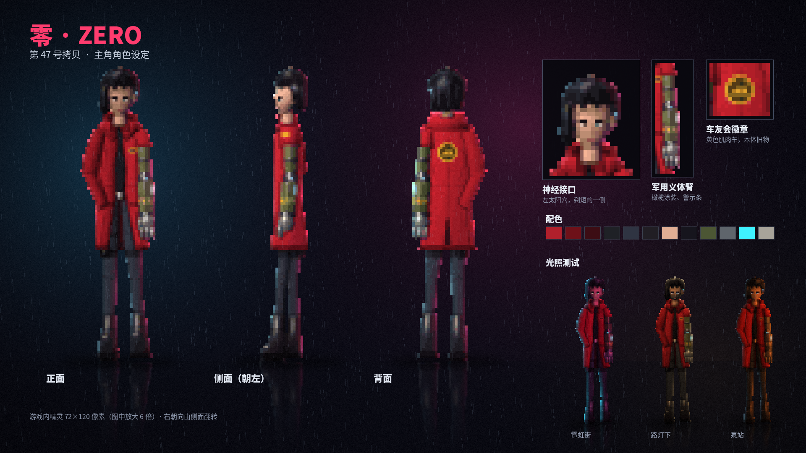

# 美术 · 主角「零」角色设定

**美术方向：高清像素 + 动态光照。精灵本身是锐利的像素，光照、泛光、雨和湿地倒影在像素之上叠加。细节密度参考雨夜赛博朋克题材的高清像素游戏。旧版美术概念图已作废。**

## 规格

| 项目 | 设定 |
| --- | --- |
| 精灵尺寸 | 72×120 像素（身高约 8 头身） |
| 视角 | 正面、侧面（朝左）、背面；朝右由侧面水平翻转 |
| 配色 | 约 60 色以内；红色风衣是全身最亮的色块，保证在暗场景里一眼认出主角 |
| 描边 | 不用黑色外描边；轮廓边缘压暗一档，部件交界处加一圈接触阴影 |
| 发光部件 | 神经接口、义体臂指示灯为青色自发光，游戏中会带泛光 |

> 注意：72×120 的精灵比原来的 32×48 大很多。如果按这个精度做，游戏的内部分辨率需要从 480×270 提高到 640×360 或更高，否则角色会占屏幕太大。这一点要和程序同学一起定。

## 设计要点

| 部位 | 设计 | 背后的故事 |
| --- | --- | --- |
| 红色风衣 | 及大腿的长风衣，高立领，前襟敞开 | 本体的衣服，零醒来时就穿着 |
| 左臂 | 旧式军用义体：橄榄色涂装、黄黑警示条、肘部和小臂有青色指示灯；左袖被扯掉 | 合成身体排斥新义体，只能用便宜的旧军用货 |
| 右手 | 习惯插在风衣口袋里 | 冷淡、无所谓的姿态 |
| 发型 | 黑色齐耳短发，厚刘海；左侧剃短 | 剃短是为了露出神经接口 |
| 神经接口 | 左太阳穴，青色发光 | 骇入能力和幽灵频道 AI 的入口 |
| 背后徽章 | 黄色圆形车友会徽章，中间是肌肉车剪影 | 本体年轻时的车友会，呼应那辆黄色肌肉车 |
| 腿部 | 深色工装裤、右大腿枪套、厚底短靴 | 雇佣兵的实用装备 |

## 光照测试

同一个精灵在三种场景光下的效果见设定图右下角：霓虹街（洋红主光 + 青色轮廓光）、路灯下（暖黄顶光）、泵站（橙色工业光）。精灵本身只带很弱的固定明暗，主要的明暗交给游戏里的动态光源，这样同一套精灵能适应所有区域。

## 下一步

1. 根据反馈调整造型。
2. 四方向行走、奔跑、射击、闪移的动画帧。
3. 再进入场景绘制：积水区的街道、后巷、泵站。
